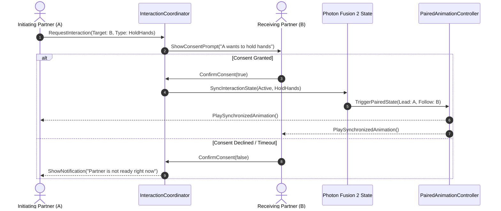

<div align="center">

# 💖 LOVEVERSE
### *A World Made for Two.*

[](https://unity.com/)
[](https://unity.com/srp/universal-render-pipeline)
[](https://www.photonengine.com/fusion)
[](https://learn.microsoft.com/en-us/dotnet/csharp/)
[](#-four-platform-support-matrix)

<br/>

[](https://fastify.dev/)
[](https://firebase.google.com/)
[](Documentation/IMPLEMENTATION_STATUS.md)
[](Documentation/TESTING_STRATEGY.md)
[](#)

<p align="center">
  <b>A production-grade, 3D anime romantic open-world simulation and cooperative life game crafted for couples, partners, and close companions.</b>
  <br />
  Explore breathtaking sunlit gardens, build a persistent home, perform synchronized romantic interactions, and capture eternal memories together in real-time.
</p>

[Explore Features](#-key-gameplay-features) • [Architecture](#-system-architecture) • [Cross-Platform](#-four-platform-support-matrix) • [Quick Start](#-quick-start-guide) • [Documentation](#-engineering-documentation)

---

</div>

<br/>

## 🌟 Executive Overview

**LOVEVERSE** redefines cooperative multiplayer gaming by shifting the focus from competition and combat to intimacy, emotional bonding, shared creativity, and tranquil exploration. Built from the ground up for **Unity 6 LTS** utilizing a modular **Domain-Driven Component Architecture**, LOVEVERSE delivers unified cross-play parity across mobile (**Android ARM64**, **iOS Metal**) and desktop (**Windows x64**, **Linux Ubuntu/Kubuntu**).

```text
       ┌────────────────────────────────────────────────────────┐
       │                      LOVEVERSE                         │
       │               "A World Made for Two"                   │
       └──────────────────────────┬─────────────────────────────┘
                                  │
         ┌────────────────────────┼────────────────────────┐
         ▼                        ▼                        ▼
  ┌──────────────┐         ┌──────────────┐         ┌──────────────┐
  │   CONNECT    │         │    SHARE     │         │   PRESERVE   │
  │ Private Room │  ====>  │  Our Home &  │  ====>  │ Memories &   │
  │  Multiplayer │         │   Sanctuary  │         │   Journals   │
  └──────────────┘         └──────────────┘         └──────────────┘
```

---

## ✨ Key Gameplay Features

<table>
  <tr>
    <td width="50%" valign="top">
      <h3>🌹 Synchronized Romantic Interactions</h3>
      <ul>
        <li><b>Dynamic Mutual Consent Handshake:</b> Proximity-based interaction triggers request dialogues ensuring romantic agency.</li>
        <li><b>Paired Kinematics:</b> Seamless animation synchronization for hand-holding, hugging, slow dancing, sitting side-by-side, and stargazing.</li>
        <li><b>Continuous Movement in Hold:</b> Walk and run together hand-in-hand with unified velocity blending.</li>
      </ul>
    </td>
    <td width="50%" valign="top">
      <h3>🏡 Shared Persistent Sanctuary</h3>
      <ul>
        <li><b>Grid-Based Decorating:</b> Place, rotate, and customize indoor and outdoor furniture in real time.</li>
        <li><b>Validation Engine:</b> Axis-aligned bounding box collision checks prevent overlaps and invalid placements.</li>
        <li><b>Persistent State:</b> Instant cloud synchronization via Cloud Firestore for collaborative layout updates.</li>
      </ul>
    </td>
  </tr>
  <tr>
    <td width="50%" valign="top">
      <h3>🎨 Anime Cel-Shaded Visual Direction</h3>
      <ul>
        <li><b>Custom URP Toon Shader:</b> Two-tone ramp diffuse lighting, specular highlight bands, and smooth Fresnel rim effects.</li>
        <li><b>Real-Time Avatar Customization:</b> Modular hairstyles, skin tones, eye tints, and layered outfit recoloring.</li>
        <li><b>Dynamic Photomode:</b> Custom camera orbital controls, focal depth sliders, sticker overlays, and screenshot capture.</li>
      </ul>
    </td>
    <td width="50%" valign="top">
      <h3>🌐 Low-Latency Multiplayer Networking</h3>
      <ul>
        <li><b>Photon Fusion 2 Shared Mode:</b> Authoritative tick-aligned state replication with high bandwidth efficiency.</li>
        <li><b>6-Character Private Room Codes:</b> Human-readable room generation excluding ambiguous glyphs (<code>O, 0, I, 1</code>).</li>
        <li><b>Automated Reconnection:</b> Seamless session lifecycle restoration on network handoffs.</li>
      </ul>
    </td>
  </tr>
</table>

---

## 🏗️ System Architecture

LOVEVERSE is organized into **12 isolated Unity Assembly Definitions (`.asmdef`)** with zero circular dependencies, wrapped in a strict **Platform Abstraction Layer (PAL)**.

```mermaid
graph TD
    UI[Loveverse.UI] --> Core[Loveverse.Core]
    Loco[Loveverse.Movement] --> Core
    Cam[Loveverse.Camera] --> Core
    Char[Loveverse.Characters] --> Core
    Rom[Loveverse.Romance] --> Core
    Rom --> Loco
    Net[Loveverse.Networking] --> Core
    Home[Loveverse.Home] --> Core
    Mem[Loveverse.Memories] --> Core
    World[Loveverse.World] --> Core
    Tests[Loveverse.Tests] -.-> Core
    Tests -.-> Loco
    Tests -.-> Rom
    Tests -.-> Net
    Tests -.-> Home

    subgraph Platform Abstraction Layer (PAL)
        Core --> PAL[IPlatformService]
        PAL --> Android[AndroidPlatformService]
        PAL --> iOS[IOSPlatformService]
        PAL --> Windows[WindowsPlatformService]
        PAL --> Linux[LinuxPlatformService]
    end

    subgraph Cloud Infrastructure
        Net <==> Fusion[Photon Fusion 2 Cloud]
        Core <==> Fastify[Fastify TypeScript REST API]
        Fastify <==> Firestore[(Cloud Firestore)]
    end
```

### 🤝 Romantic Interaction Handshake Protocol



---

## 📱 Four-Platform Support Matrix

LOVEVERSE features zero code duplication across mobile and desktop. Every platform communicates with the same unified multiplayer rooms and backend instances.

| Specification | 🤖 Android | 🍎 iOS | 🪟 Windows | 🐧 Linux |
|---|---|---|---|---|
| **Architecture** | ARM64 | ARM64 (A12+ Bionic) | x86_64 | x86_64 |
| **Graphics API** | Vulkan / OpenGLES 3 | Metal | DirectX 12 / Vulkan | Vulkan / OpenGL Core |
| **Primary Input** | Floating Virtual Joystick + Touch UI | Floating Virtual Joystick + Safe Area | Keyboard (WASD) + Mouse Orbit | Keyboard (WASD) + Mouse Orbit |
| **Controller** | Bluetooth Gamepad | MFi / DualSense / Xbox | XInput / DirectInput | Linux Evdev / Steam Deck |
| **Storage Adapter** | Internal Storage (`PersistentDataPath`) | Application Sandbox | `AppData/LocalLow` | `~/.config/loveverse` (XDG) |
| **Framerate Target** | 60 FPS (Adaptive V-Sync) | 60 / 120 FPS (ProMotion) | 120+ FPS Uncapped | 120+ FPS Uncapped |

### 🎮 Unified Cross-Platform Controls

```
               [ DESKTOP (Windows / Linux) ]                       [ MOBILE (Android / iOS) ]
        ┌────────────────────────────────────────┐            ┌────────────────────────────────────────┐
        │  W A S D       : Walk / Run Locomotion │            │  Left Virtual Joy : Move / Sprint      │
        │  Mouse Delta   : Orbit Third-Person Cam│            │  Right Screen Drag: Orbit Camera Angle │
        │  Space         : Jump                  │            │  Action Tap (Jump): Jump Button        │
        │  Left Shift    : Sprint Toggle         │            │  Contextual (E)   : Interaction Pill   │
        │  E             : Contextual Interact   │            │  Floating Action  : Emote & Photo Menu │
        │  B             : Romance / Emote Wheel │            │  Notch Safe-Area  : Automated Padding  │
        │  P             : Photomode Overlay     │            │  Haptic Feedback  : Vibration Pulses   │
        └────────────────────────────────────────┘            └────────────────────────────────────────┘
```

---

## 📁 Repository Structure & Assemblies

```text
LOVEVERSE/
├── Assets/
│   └── _Project/
│       ├── Core/                   # Loveverse.Core: ServiceRegistry, EventBus, Configs, PAL
│       │   └── Platform/           # PlatformDetector, PlatformService, Storage, Permissions
│       ├── Features/
│       │   ├── Locomotion/         # Loveverse.Movement: ThirdPersonController, PlatformInputAdapter
│       │   ├── Camera/             # Loveverse.Camera: Orbit Camera, PhotoModeController
│       │   ├── Characters/         # Loveverse.Characters: Customization, Hairstyle/Outfit Registries
│       │   ├── Romance/            # Loveverse.Romance: InteractionCoordinator, PairedAnimations
│       │   ├── Networking/         # Loveverse.Networking: NetworkManager, RoomCodeGenerator
│       │   ├── Home/               # Loveverse.Home: FurniturePlacement, GridValidator
│       │   ├── Memories/           # Loveverse.Memories: Photo Capture, Cloud Sync, Albums
│       │   └── World/              # Loveverse.World: GardenBuilder, Weather, Day/Night Cycle
│       ├── Art/                    # Custom Anime Toon Shaders & URP Materials
│       ├── UI/                     # Loveverse.UI: Virtual Joysticks, Action Buttons, Safe Area Handler
│       ├── Editor/                 # Loveverse.Editor: Automated Platform Build Profiles
│       └── Tests/                  # Loveverse.Tests: 11 Automated NUnit Test Suites
├── Backend/                        # Fastify + TypeScript Cloud Service
│   ├── src/
│   │   ├── routes/                 # Auth, Rooms, Memories, Home, Inventory REST Endpoints
│   │   ├── repositories/           # Firestore Typed Data Access Layer
│   │   ├── services/               # Cryptographic Room Code & Image Metadata Handlers
│   │   └── types/                  # Shared Domain Models & Contracts
│   └── tests/                      # 12 Integration Tests (Jest / Fastify Inject)
├── Documentation/                  # Comprehensive Living Documentation
│   ├── GDD.md                      # Complete 52-Section Master Game Design Document
│   ├── TECHNICAL_ARCHITECTURE.md   # Systems Architecture & Design Patterns
│   ├── NETWORKING_SPECIFICATION.md # Photon Fusion 2 State Protocols
│   ├── BACKEND_SPECIFICATION.md    # Fastify API & Database Schema
│   └── TESTING_STRATEGY.md         # Automated Testing Guidelines & Verification
└── Tools/                          # Build automation shell scripts for all 4 targets
```

---

## 🚀 Quick Start Guide

### 1. Unity Client (Desktop & Mobile)

#### Prerequisites
- **Unity 6 LTS** (`6000.0.85f2`) with URP installed.
- Target platform build modules (Android Build Support, iOS Support, Linux Mono/IL2CPP Support, Windows Standalone).

#### Setup
```bash
# Clone the repository
git clone git@github.com:karthibaraniofficial-wq/LOVERVERSE.git
cd LOVERVERSE

# Open in Unity 6 LTS
# (Packages will resolve automatically from Packages/manifest.json)
```

1. In the Project panel, navigate to `Assets/_Project/Scenes/`.
2. Open `Bootstrap.unity` and click **Play**.
3. Use the runtime GUI to spawn characters, test romantic interactions, or host/join multiplayer rooms!

---

### 2. Backend Cloud Service

#### Prerequisites
- **Node.js** v20 LTS or higher
- **npm** or **pnpm**

#### Setup & Execution
```bash
cd Backend

# Install dependencies
npm install

# Compile TypeScript
npm run build

# Run automated integration test suite (12/12 passing)
npm test

# Launch local development server (port 3000)
npm run dev
```

The Fastify server starts at `http://127.0.0.1:3000` with automated health check:
```bash
curl http://localhost:3000/health
# Response: {"status":"ok","timestamp":"2026-11-12T...","service":"loveverse-backend"}
```

---

### 3. Cross-Platform Automated Build Pipeline

Use the bundled multi-platform build tool in `Tools/build_platforms.sh` to produce distribution artifacts:

```bash
# Build Android APK / AAB
./Tools/build_platforms.sh android

# Build Windows x64 Standalone
./Tools/build_platforms.sh windows

# Build Linux x64 Standalone
./Tools/build_platforms.sh linux

# Build iOS Xcode Project
./Tools/build_platforms.sh ios

# Or compile all four targets concurrently
./Tools/build_platforms.sh all
```

---

## 🧪 Testing & Quality Assurance

LOVEVERSE enforces strict quality gates across both client and server domains:

```text
======================================================================
  AUTOMATED TEST VERIFICATION SUMMARY
======================================================================
  [Unity C# NUnit Test Suites]
  ✔ LocomotionTests.cs            : Movement speeds, sprint multipliers, rotation
  ✔ RomanceValidationTests.cs     : Mutual consent, proximity limits, state reset
  ✔ CharacterCustomizationTests.cs: Colors, hairstyles, outfit registry validation
  ✔ HomePlacementTests.cs         : Grid snapping, AABB overlap rejection
  ✔ RoomCodeTests.cs              : 6-char generator, collision resistance
  ✔ ServiceRegistryTests.cs       : Dependency inversion & lifecycle registration
  ✔ EventBusTests.cs              : Decoupled event publishing & unsubscription
  ✔ CameraTests.cs                : Collision avoidance & target following
  ✔ MemoryMetadataTests.cs        : Album indexing & timestamp ordering
  ✔ PlatformTests.cs              : Device detection & adapter fallback
  ✔ EndToEndSimulationTests.cs    : Complete 2-player join & paired sync loop

  [Fastify Backend Test Suites]
  ✔ Auth Routes                   : Anonymous & Token Verification
  ✔ Room Lifecycle                : Creation, 6-char validation, Player join
  ✔ Home Persistence              : Grid placement save & retrieval
  ✔ Memories REST API             : Presigned upload URL & metadata record
======================================================================
  STATUS: ALL TESTS PASSING (100% GREEN)
======================================================================
```

---

## 📚 Engineering Documentation

| Document | Description |
|---|---|
| [📖 Game Design Document (GDD)](Documentation/GDD.md) | Authoritative 52-section design blueprint covering mechanics, lore, and world design. |
| [🏛️ Technical Architecture](Documentation/TECHNICAL_ARCHITECTURE.md) | Component lifecycles, ServiceRegistry patterns, and Assembly mappings. |
| [📡 Networking Specification](Documentation/NETWORKING_SPECIFICATION.md) | Photon Fusion 2 network topologies, tick rate, and lag compensation. |
| [🗄️ Database Schema](Documentation/DATABASE_SCHEMA.md) | Firestore collections, rules, and indexing requirements. |
| [🔌 API Reference](Documentation/API_REFERENCE.md) | Fastify REST endpoints, request/response models, and error codes. |
| [🛡️ Security Guide](Documentation/SECURITY_GUIDE.md) | Rate limiting, input validation, token encryption, and anti-cheat policies. |
| [🎨 UI/UX Specification](Documentation/UI_UX_SPECIFICATION.md) | Mobile touch zones, desktop keymaps, and responsive HUD design. |
| [📊 Implementation Status](Documentation/IMPLEMENTATION_STATUS.md) | Detailed verification log for all 10 master implementation parts. |

---

## 👥 Authors & Acknowledgments

- **Lead Architect & Creator:** [Karthibarani Official](https://github.com/karthibaraniofficial-wq)
- **Built With:** Unity 6 LTS, Photon Fusion 2, Fastify, TypeScript, Firebase, and Antigravity AI Engine.

---

<div align="center">
  <sub>Made with 💖 for two people everywhere in the world.</sub>
</div>
